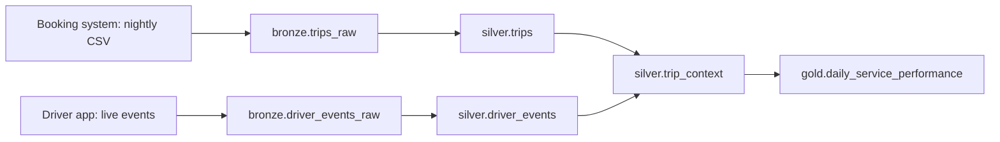

# Phase 2: add live driver-app events

## Story and goal

Passengers report that "pickup wait" mixes two delays: the driver's travel to the pickup point and the time after the driver arrives. MetroRide now ingests driver-app events as they happen. The nightly trip batch remains authoritative for trip status and fare. The app stream supplies the driver's arrival time and GPS position.

## Data flow

## Bronze tables and sample files

| Table and grain | June | July | August | Raw CSV schema |
|---|---|---|---|---|
| `bronze.trips_raw`: one booking row per `trip_id` | [trips](bronze/trips_2026-06.csv) | [trips](bronze/trips_2026-07.csv) | [trips](bronze/trips_2026-08.csv) | `trip_id`, `driver_id`, `service_zone`, `requested_at`, `accepted_at`, `picked_up_at`, `completed_at`, `cancelled_at`, `status`, `fare_thb`; all text, with blank values for fields absent on cancellations. |
| `bronze.driver_events_raw`: one received event row | [events](bronze/driver_events_2026-06.csv) | [events](bronze/driver_events_2026-07.csv) | [events](bronze/driver_events_2026-08.csv) | `event_id`, `trip_id`, `driver_id`, `event_type`, `event_at`, `latitude`, `longitude`; all text. |

The trip CSV schema is unchanged from [phase 1](../phase-1-batch/README.md). The app CSV represents a live stream persisted as monthly files for class use. It includes one repeated `gps_ping` delivery in each month; bronze keeps both received copies. April and May trip rows remain in the lakehouse after loading these files, but they have no app events.

## Silver tables

| Table and grain | Schema | Main rule |
|---|---|---|
| `silver.trips`: one row per `trip_id` | `trip_id` text key; `driver_id`, `service_zone`, `status`, `time_slot` text; `requested_at`, `accepted_at` required timestamptz; `picked_up_at`, `completed_at`, `cancelled_at` nullable timestamptz; `fare_thb` nullable decimal(10,2); `service_date` date. | Same validation as phase 1. |
| `silver.driver_events`: one row per `event_id` | `event_id` text key; `trip_id`, `driver_id`, `event_type` text; `event_at` timestamptz; `latitude`, `longitude` decimal(9,5). | Deduplicate identical repeated event IDs; reject conflicting IDs or invalid coordinates. |
| `silver.trip_context`: one row per `trip_id` | All columns from `silver.trips`; `driver_arrived_at` nullable timestamptz; `driver_arrival_wait_minutes` nullable decimal(8,2); `passenger_pickup_wait_minutes` nullable decimal(8,2). | Join the unique `arrived_at_pickup` event and calculate both waits. |

The accepted `event_type` values are `accepted`, `gps_ping`, `arrived_at_pickup`, and `cancelled`. Completed trips have exactly one arrival event. Cancelled trips have no arrival event in these fixtures.

## Gold table and indicators

`gold.daily_service_performance` still has one row per `service_date` and `time_slot`.

| Column | Type | Calculation from `silver.trip_context` |
|---|---|---|
| `service_date`, `time_slot` | date, text | Group key. |
| `requests`, `completed_trips`, `cancelled_trips` | integer | Count all, completed, and cancelled trips. |
| `cancellation_rate_pct` | decimal(5,2) | `100 × cancelled_trips / requests`. |
| `gross_fare_thb` | decimal(12,2) | Sum fares for completed trips. |
| `average_passenger_pickup_wait_minutes` | decimal(8,2), nullable | Average request-to-passenger-pickup minutes for completed trips. |
| `average_driver_arrival_wait_minutes` | decimal(8,2), nullable | Average request-to-driver-arrival minutes for completed trips. |
| `arrived_within_8_minutes_pct` | decimal(5,2), nullable | `100 × completed trips with driver arrival wait <= 8 / completed trips with an arrival event`; null if no arrival events are available. |

## Transformations

**Bronze → silver.** Apply phase 1 trip checks. Parse app event timestamps and coordinates, restrict latitude to `[-90, 90]` and longitude to `[-180, 180]`, and accept only the four event types above. Keep one copy of each identical `event_id`. Reject a reused ID with different content. Match event `trip_id` and `driver_id` to a validated trip. For completed trips dated June onward, require an arrival event between acceptance and passenger pickup. Left join by `trip_id`; check that `silver.trip_context` has one row per trip. April–May trips and cancelled trips have null driver arrival fields.

**Silver → gold.** Aggregate the same trip counts, fares, and passenger pickup wait as phase 1. Add driver arrival wait and the eight-minute target from the app event. Calculate the target percentage only over completed trips with an arrival event, leaving it null for April–May. If a live event arrives after the day's first report, update that day's gold row once the matched trip is valid.

**Schema evolution from phase 1:** add `bronze.driver_events_raw`, `silver.driver_events`, and `silver.trip_context`. Keep `bronze.trips_raw` and `silver.trips` unchanged. Add `average_driver_arrival_wait_minutes` and `arrived_within_8_minutes_pct` to the gold schema; its date-and-slot grain does not change.
