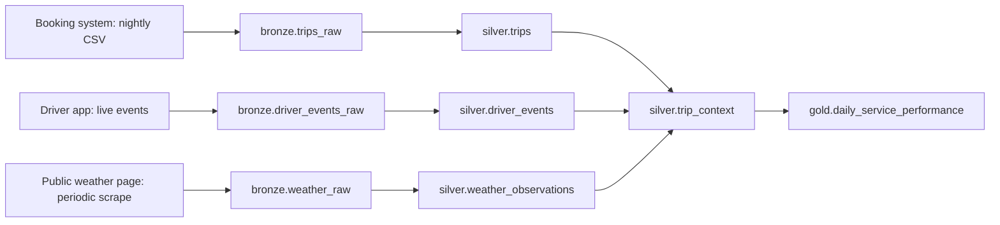

# Phase 3: add rainfall from a public web page

## Story and goal

MetroRide's manager notices longer arrival waits on some evenings and suspects rain. The team adds a periodic collector for the [Thai Meteorological Department's Bangkok weather page](https://www.tmd.go.th/weather/province/bangkok). The sample rainfall values here are **synthetic**, so students can run the exercise without depending on a changing website. They are not a historical TMD extract. A real collector must follow the site's access rules.

The goal is to compare demand, cancellation rate, and driver arrival wait in rainy and dry periods. The comparison describes an association; it does not prove that rain caused a delay.

## Data flow

## Bronze tables and sample files

| Table and grain | September file | Raw CSV schema |
|---|---|---|
| `bronze.trips_raw`: one booking row per `trip_id` | [trips](bronze/trips_2026-09.csv) | `trip_id`, `driver_id`, `service_zone`, `requested_at`, `accepted_at`, `picked_up_at`, `completed_at`, `cancelled_at`, `status`, `fare_thb`; source text. |
| `bronze.driver_events_raw`: one received event | [events](bronze/driver_events_2026-09.csv) | `event_id`, `trip_id`, `driver_id`, `event_type`, `event_at`, `latitude`, `longitude`; source text. |
| `bronze.weather_raw`: one Bangkok observation per date and slot | [weather](bronze/weather_2026-09.csv) | `observed_at`, `city`, `time_slot`, `rain_mm`, `source_page`; source text. |

Each weather row represents an 08:00 morning or 18:00 evening observation. `source_page` records the intended public source. A production collector should also record retrieval time and page version or hash in bronze metadata. The April–August trip rows loaded in earlier phases remain available, but only September has weather observations.

## Silver tables

| Table and grain | Schema | Main rule |
|---|---|---|
| `silver.trips`: one row per `trip_id` | `trip_id` text key; `driver_id`, `service_zone`, `status`, `time_slot` text; `requested_at`, `accepted_at` required timestamptz; `picked_up_at`, `completed_at`, `cancelled_at` nullable timestamptz; `fare_thb` nullable decimal(10,2); `service_date` date. | Same validation as phases 1 and 2. |
| `silver.driver_events`: one row per `event_id` | `event_id` text key; `trip_id`, `driver_id`, `event_type` text; `event_at` timestamptz; `latitude`, `longitude` decimal(9,5). | Same event cleanup as phase 2. |
| `silver.weather_observations`: one row per `city`, `service_date`, `time_slot` | `city`, `time_slot`, `source_page` text; `observed_at` timestamptz; `service_date` date; `rain_mm` decimal(6,1); `is_rainy` boolean. | Require nonnegative rainfall and classify rain at `rain_mm >= 1.0`. |
| `silver.trip_context`: one row per `trip_id` | All columns from `silver.trips`; `driver_arrived_at` nullable timestamptz; `driver_arrival_wait_minutes`, `passenger_pickup_wait_minutes` nullable decimal(8,2); `rain_mm` nullable decimal(6,1); `is_rainy` nullable boolean. | Join arrival event by trip, then weather by city, date, and slot. |

## Gold table and indicators

`gold.daily_service_performance` now has one row per `service_date`, `time_slot`, and **weather class**. `is_rainy = null` is its own "weather unavailable" class; never treat it as dry.

| Column | Type | Calculation from `silver.trip_context` |
|---|---|---|
| `service_date`, `time_slot`, `is_rainy` | date, text, nullable boolean | Group key; `true` means `rain_mm >= 1.0`. |
| `requests`, `completed_trips`, `cancelled_trips` | integer | Count all, completed, and cancelled trips. |
| `cancellation_rate_pct` | decimal(5,2) | `100 × cancelled_trips / requests`. |
| `gross_fare_thb` | decimal(12,2) | Sum fares for completed trips. |
| `average_passenger_pickup_wait_minutes` | decimal(8,2), nullable | Average request-to-passenger-pickup minutes for completed trips. |
| `average_driver_arrival_wait_minutes` | decimal(8,2), nullable | Average request-to-driver-arrival minutes for completed trips. |
| `arrived_within_8_minutes_pct` | decimal(5,2), nullable | `100 × completed trips with driver arrival wait <= 8 / completed trips with an arrival event`; null if none are available. |

## Transformations

**Bronze → silver.** Keep phase 2 trip and app-event rules. Parse weather `observed_at` with its timezone and `rain_mm` as a nonnegative number. Deduplicate by city, Bangkok service date, and slot; conflicting observations need review. Classify `is_rainy` at the stated threshold. Join each trip to its arrival event and Bangkok observation for the request's date and slot. Keep April–August trips with null weather fields; April–May also have null driver arrival fields. Check that neither join duplicates trips. In a production design, use the closest valid observation in space and time with a maximum allowed age; the two daily slots simplify this exercise.

**Silver → gold.** Group by date, slot, and weather class. Apply the phase 2 measure formulas. Compare rainy and dry periods using **September only**, since earlier months have no weather observations. Sum requests, completed trips, and cancelled trips across daily rows before calculating cancellation rate. Weight the overall average arrival wait by completed trips with an arrival event; do not average daily percentages or means without weights. Round displayed rates and minutes after aggregation.

**Schema evolution from phase 2:** add `bronze.weather_raw` and `silver.weather_observations`. Add nullable `rain_mm` and `is_rainy` to `silver.trip_context`. Add nullable `is_rainy` to the gold grouping key, so a prior date-and-slot row may split by weather class. Earlier bronze CSV schemas and silver source tables do not change.

## Expected September check

| Weather class | Requests | Completed | Cancelled | Cancellation rate | Average driver arrival wait |
|---|---:|---:|---:|---:|---:|
| Dry | 96 | 92 | 4 | 4.17% | 6.95 minutes |
| Rainy | 36 | 32 | 4 | 11.11% | 11.16 minutes |

The generator deliberately makes rainy slots busier and slower. Use these values to check a student pipeline, not as real business or weather findings.
